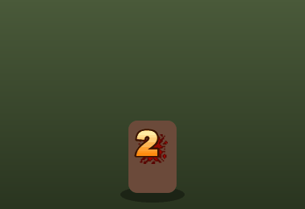
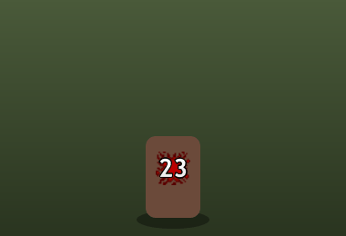
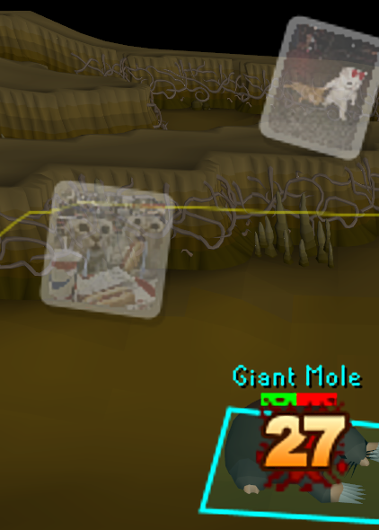

# Fancy Hitsplats

Damage numbers in the style of MapleStory or World of Warcraft.

| MapleStory | World of Warcraft |
|---|---|
|  |  |

In game, MapleStory style with the image burst on:

## Features

- **Two styles**
  - **MapleStory**: chunky gradient numbers that pop in digit by digit. Max hits turn pink-red with a starburst and a "CRITICAL" label.
  - **World of Warcraft**: clean numbers that drift up and away. Crits pop in big and yellow.
- **Sits on the real hitsplat.** Each number covers the game's own splat while it's on screen, then floats up once it's gone. It follows the same slots the game uses when several hits land at once. You can also have numbers start above the head instead.
- **Backing plate.** A bigger copy of the game's own splat sits behind the number, so the real splat can't peek out around small numbers.
- **Hide normal hitsplat backgrounds (optional).** Makes the game's splat images invisible on your screen. Splats that aren't shown fancy, such as hits on you, are redrawn to look like the normal ones.
- **Who gets fancy numbers.** Choose any of: your hits, other players' hits on monsters, damage you take, heals, poison/venom/burn, misses. By default, damage landing on players stays normal.
- **Image burst (optional).** When you hit something, 3 random pictures from your own collection pop out above the hit like stickers and fade away.
- **Adjustable** size, duration, number opacity (for see-through numbers with a bold outline), plate size and crit threshold.

## Image burst

Open the **Fancy Hitsplats** panel from the sidebar (orange star icon):

1. Click **Add pictures...** and pick as many PNG, JPG or GIF files as you like. GIFs show their first frame.
2. The pictures are copied into `.runelite/plugin-data/fancy-hitsplats/pictures`.
3. Each of your hits shows 3 of them at random.

**Remove all pictures** clears the list. Pictures never leave your computer.

## Notes

- The client can't remove the number the game draws on its own hitsplats. The fancy number is drawn on top of it, and the backing plate covers the splat.
- After changing **Hide normal hitsplat backgrounds**, restart the client. Splats the game has already loaded keep their old look until then.
